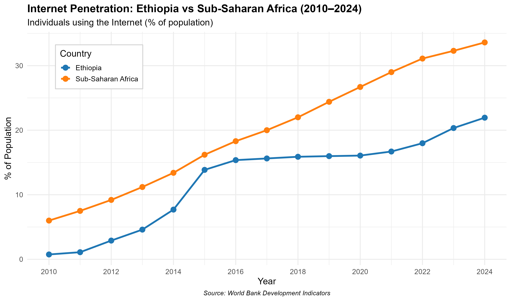

# Architecture of Growth: Ethiopia’s Digital Economy Success Story (2010-2024) #
**Comparative Analysis vs Sub-Saharan Africa using World Bank Data**

  

## Project Overview

This project examines the evolution of Ethiopia’s ICT infrastructure and digital readiness from 2010 to 2024. Using World Bank Development Indicators, it benchmarks Ethiopia’s performance against the Sub-Saharan Africa (SSA) average and analyzes the relationship between digital connectivity (internet penetration and mobile subscriptions) and economic output (GDP per capita).

The analysis supports monitoring progress toward **SDG 9** — Industry, Innovation and Infrastructure.

## Data Cleaning Notes
All cleaning decisions are documented inside **data_cleaning_script.R**.

Key points:

- World Bank “..” values are treated as missing.
- Metadata rows at the bottom of the export are dropped.
- Only Ethiopia and Sub-Saharan Africa are retained.
- Genuine 2018 data gaps for Ethiopia (mobile & fixed broadband) are left as NA and are not imputed.

## Key Findings

- Ethiopia has achieved strong growth in mobile connectivity, reaching over 65 subscriptions per 100 people by 2024.
- Internet penetration has improved significantly since the 2018 telecom reforms but still lags the SSA average (21.9% vs 33.6%).
- Linear regression shows a **strong positive relationship** in Ethiopia: A 1% increase in internet penetration is associated with approximately **$33 higher GDP per capita** (R² = 0.876, p < 0.001).
- The economic multiplier of internet usage is more than double that of basic mobile subscriptions.

## Methodology & Tech Stack

- **Language**: R
- **Key Packages**: `tidyverse` (Data Wrangling), `ggplot2` (Visualization), `broom` (Statistical Modeling), `knitr` (Reporting)
- **Techniques**: Data cleaning, time-series analysis, OLS linear regression, comparative visualization
- **Data Source**: World Bank Open Data (Development Indicators)

## Repository Structure
      ethiopias-digital-readiness-r/
    	├── Plots 								#Folder containing plots produced for the analysis
		├── README.md
		├── data_cleaning_script.R 				#Reproducible cleaning script
    	├── analysis.Rmd    					#The master R Markdown file (sources cleaning script)
    	├── analysis.html:       				#The final knitted report
    	├── digital_inclusion_raw.csv    		# original World Bank export
		├──digital_inclusion_clean_wide.csv  	# cleaned wide data (for models)
		└──digital_inclusion_clean_long.csv  	# cleaned tidy long data
                   
## How to Reproduce

1. Clone this repository
2. Open the project in RStudio (or set the working directory to the project root)
3. Install required packages:
   ```r
   install.packages(c("tidyverse", "ggplot2", "broom", "knitr"))
   ```
4. Open analysis.Rmd and knit the document
(The cleaning script is automatically sourced at the start of the analysis)
Alternatively, you can run the cleaning script on its own

## Future Improvements ##
- Build an interactive Power BI dashboard
- Add more SSA peer countries for richer regional comparison
- Extend the time series as new WDI updates become available

Author: Mathyas Tilahun

Date: April 2026
